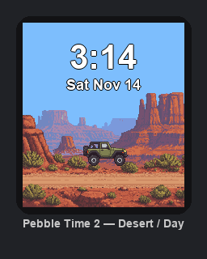
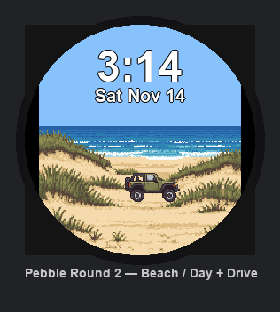
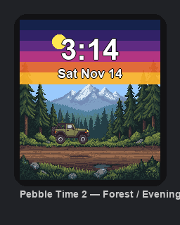
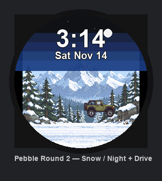

# Jeep Trails

Jeep-themed watch face for **Pebble Time 2** (`emery`) and **Pebble Round 2** (`gabbro`).

Each day opens a new trail scene. The sky follows real time of day (morning, day, evening, night). Once per hour, a Jeep drives across the trail, following the terrain. Time and date sit in the sky.

Graphics were generated with [PixelLab](https://pixellab.ai).

## Screenshots

| Time 2 | Round 2 |
| --- | --- |
|  |  |
|  |  |

More: `screenshots/emery_night.png`, `screenshots/emery_morning_drive.png`.

## Features

- **7 daily trails** (day-of-year rotation): Desert Canyon, Forest Trail, Mountain Pass, Beach Dunes, Snowy Alpine, Farm Country, Moab Slickrock
- **Time-of-day sky** overlays with sun/moon
- **Hourly Jeep drive** with wheel animation and terrain-following path
- **Clay settings**: text color, date on/off, bold time, scene mode (daily/fixed), fixed scene, drive minute, vibrate on drive

## CloudPebble

1. Open [CloudPebble](https://cloudpebble.repebble.com)
2. **Import from GitHub** → this repository
3. Confirm dependency `@rebble/clay`
4. Build for **emery** / **gabbro**
5. Install via emulator or phone

Project layout is standard SDK 4 / CloudPebble C + PebbleKit JS.

## Local build

Requires the [Pebble SDK](https://developer.repebble.com/) (`pebble-tool`) with a working ARM toolchain (Linux/macOS or WSL recommended on Windows).

```bash
pebble build
pebble install --emulator emery
pebble install --emulator gabbro
```

## Settings (Clay)

Open the watch face settings gear in the Pebble mobile app:

- Time / date color
- Show date
- Bold time font
- Scene mode: changes each day, or fixed scene
- Hourly drive on/off, which minute of the hour, optional vibe

## Appstore description

**Short**

Daily Jeep trail scenes with real time-of-day skies and an hourly off-road drive.

**Long**

Hit the trail every time you check your wrist. Jeep Trails cycles through seven PixelLab-crafted landscapes—desert canyons, forest paths, mountain passes, beaches, snow, farm country, and Moab slickrock. The sky shifts from morning glow to midday blue, sunset, and starry night with the real clock. Once an hour, your Jeep fires up and rolls across the terrain. Customize colors, scene mode, and drive timing with Clay settings. Built for Pebble Time 2 and Pebble Round 2.

## License

Assets © generated for this project via PixelLab. Code Apache-2.0 style — free to use and modify.
